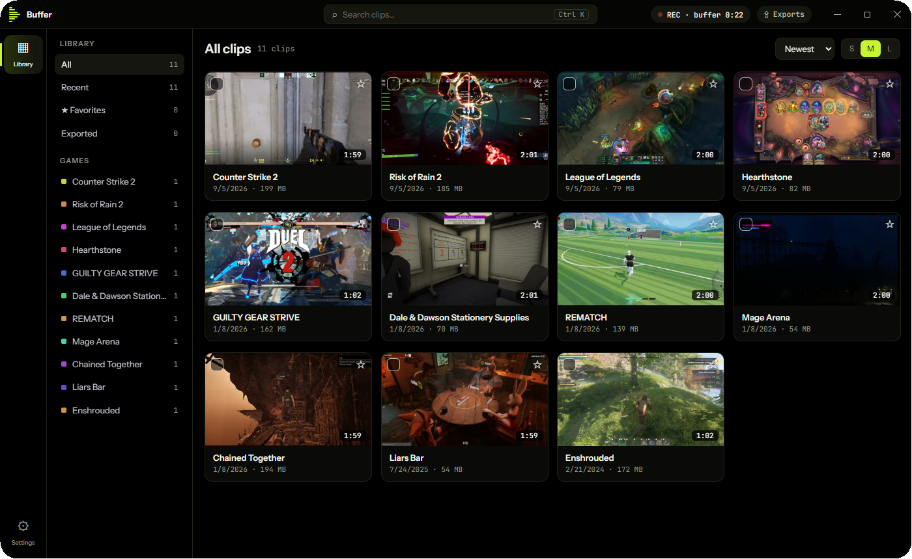
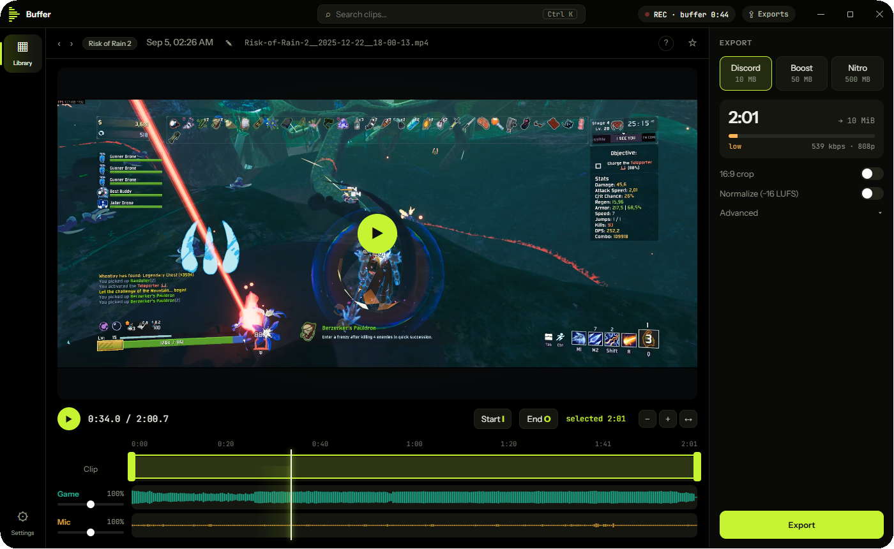

<div align="center">

# Buffer

### Save the clip **after** it happens.

Always-on clip recorder and editor for Windows.

[**Download for Windows**](https://github.com/Wheatlay/Buffer/releases/latest)  ·  Windows 10 and 11  ·  installs in a minute

</div>

---

Small on purpose. No launcher, no account, no overlay, nothing to babysit.

| | |
|---|---|
| **9 MB** | the whole installer |
| **0** | questions during install |
| **1** | hotkey to save a clip |

<p align="center">
  <br>
  <sub>Library. Every clip, sorted by game.</sub>
</p>

<p align="center">
  <br>
  <sub>Editor. Trim, pick a size, drag it into Discord.</sub>
</p>

## What it does

- **Always-on recorder.** Buffer keeps the last minutes in the background (NVENC when your GPU has it). Press one hotkey and the moment that just happened is saved as an MP4.
- **Three audio tracks.** Game, voice chat and microphone are saved separately, so you can mute your friends or fix your mic afterwards. Devices that disappear are picked up again automatically, and Buffer warns you when your mic is also playing through the speakers and ending up in the game track.
- **Library.** Every clip, sorted by game or grouped by date (collapse or expand all with one click), with favorites, search and bulk actions. Stays smooth with thousands of clips, and clips from other recorders are filed by their folder.
- **Editor.** Trim, 16:9 crop, speed, per-track volume and loudness, a zoomable timeline.
- **Exports to a size.** Pick Discord (10 MB), Boost (50 MB) or Nitro (500 MB) and drag the result straight into a chat window.
- **Updates itself.** Signed updates are checked in the background; installing takes a few seconds, and the bundled FFmpeg is only rewritten when it changed.
- **Your language.** English, Polski, Deutsch, Español, Français, Українська, Türkçe, 日本語 and 简体中文.

## Install

Download the latest installer from [Releases](https://github.com/Wheatlay/Buffer/releases/latest) and run it. It is per-user, asks nothing, and opens a short first-run setup when it is done.

## Build from source

Rust workspace plus a [Tauri v2](https://tauri.app) app with a plain HTML/CSS/JS interface (no bundler).

```powershell
.\scripts\dev.ps1            # debug build, the UI reloads when you save a file
.\build-installer.ps1        # release installer (fetches and verifies ffmpeg)
```

Architecture notes are in [STATE.md](STATE.md), release steps in [RELEASING.md](RELEASING.md), and translations live in `ui/js/locales/` (`node scripts/check-i18n.js` checks them).

## License

[MIT](LICENSE). Buffer ships with a GPL build of ffmpeg; see [THIRD-PARTY-NOTICES.md](THIRD-PARTY-NOTICES.md).
